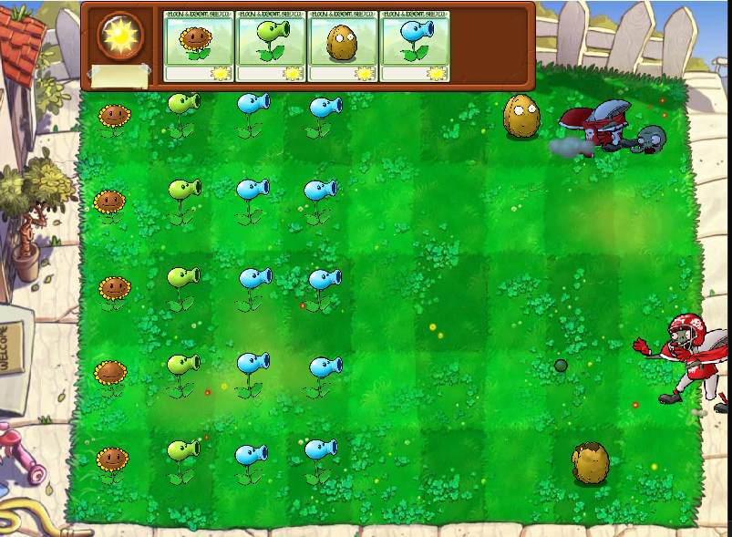

# LawnGL

A Plants vs. Zombies style lawn defense game I'm writing in C++ on top of my own small OpenGL engine. No Unity, no SDL, no game framework. Just a window, some shaders and a lot of sprites.

I started this mostly to learn how a 2D engine actually works under the hood, and making a game on top of it felt like the best way to find out what was missing.



## What's in it right now

- A 5-row lawn grid you can place plants on
- A seed bank at the top with a sun counter
- Plants: Sunflower, Peashooter, Wall-nut and Snow Pea
- Zombies: the regular one and the Football Zombie
- Wall-nut cracks in two stages as it gets eaten
- Snow Pea slows zombies down and tints them blue while they're frozen
- Zombies walk, eat, and fall apart when they die (head pops off, arm drops, the whole thing)

More plants and zombies unlock as you go. That part is still being filled in.

## The engine

Everything is hand-rolled on top of OpenGL:

- **GameObjects + Behaviours**: a small component setup. Gameplay code lives in behaviours like `ZombieBehaviour` and gets pulled with `GetBehaviour<T>()`.
- **SpriteRenderer / Material / Shader**: each object has a texture, a material and a layer for draw order. Sprites can be tinted per object, which is how the frozen effect works.
- **AnimationController**: plays cut-out animations. Every character is split into body parts (head, jaw, arms, legs...) and a JSON file says where each part is on every frame. `PixelsPerUnit`, `ObjectScale` and `Origin` control how it maps onto the screen.
- **Move tool**: a Unity-style tool to click and drag objects around while testing.

### Scenes and levels

Nothing about a level is hardcoded. The scene manager loads scenes at runtime, and every scene lives in its own file that lists the GameObjects it contains. Switching scenes just means unloading one file's objects and loading another's.

Levels sit on top of that. A level file says which scenes it uses and which plants and zombies are allowed in it, so a new level is mostly a new data file instead of new code. Adding a plant or zombie works the same way: give it its data and animation files and any level can pull it in. That's what keeps the game easy to grow.

### Resource management

Textures, shaders and materials are loaded once and then shared. The first time something asks for a texture, it gets loaded from disk. After that everyone gets the same copy. Fifty zombies on the lawn still means one `ZombieHead` texture on the GPU, not fifty. Scene switches don't reload anything that's already in memory either, so jumping between scenes stays quick.

### How the animations are made

I don't draw frames. Each character is cut into parts, rigged and animated in a separate Unity project, then exported as per-frame JSON that the engine reads. A frame looks like this:

```json
{
  "FrameIndex": 0,
  "FrameExecutionMoment": 0.0,
  "FrameConfig": [
    { "Name": "ZombieHead", "Position": [-0.521, 2.37], "Scale": [1.91, 1.84], "Rotation": [0, 0, -7.18] },
    { "Name": "ZombieDust", "Position": [0, 0], "Scale": [1, 1], "Rotation": [0, 0, 0], "Active": false }
  ]
}
```

`Name` is the part's image file, `Active: false` hides a part on that frame, and an optional `Alpha` fades it. Plants are authored at 100 pixels per unit and zombies at 53.116. If a character looks like it exploded into pieces, that number is the first thing to check.

## Building

Windows + Visual Studio.

1. Clone the repo
2. Open the solution in Visual Studio
3. Build and run (x64)

Libraries used: GLFW, glad, GLM and stb_image.

Textures and shaders get loaded through `Paths::Texture()` and `Paths::Shader()`, so keep the resources folder next to the executable or the game will start with a lot of missing sprites.

## Controls

- Click a seed packet, then click a tile to plant it
- Click sun coming out of a sunflower to collect it

## Things I want to add

- More plants and zombies
- Proper level progression
- Waves System
- Text
- Sound
- Lawnmowers
- A main menu that isn't just me pressing run in Visual Studio

## Credits

This is a fan project made for learning. Plants vs. Zombies and all of its art and characters belong to PopCap Games / Electronic Arts. I'm not selling this or claiming any of the original art as my own.

Code by Mohib.